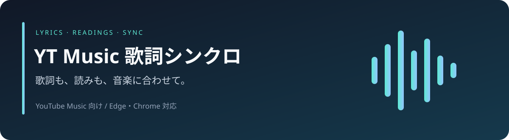

# YT Music 歌詞シンクロ 2.9.1

2.9.1のUI・歌詞追従の改善に加え、設定画面で読み仮名をOFFにしても曲別設定によって再表示される問題を修正しました。

<div align="center">



**YouTube Musicに、追いかけやすい歌詞と読み仮名を。**


[](LICENSE)

[**📦 ダウンロード**](https://github.com/taruYDK/ytm-lyrics-sync/releases) · [**🚀 インストール**](#インストール) · [**📖 使い方**](#使い方) · [**📝 変更履歴**](CHANGELOG.md) · [**💬 不具合・要望**](https://github.com/taruYDK/ytm-lyrics-sync/issues)

</div>

## できること

| 機能 | 内容 |
| --- | --- |
| 🎵 歌詞を追跡 | 再生に合わせて行・単語をハイライト。ふりがなも本文と一緒に追跡します。 |
| 🔤 読み仮名を表示・編集 | 漢字にひらがな、英語にカタカナ。日本語と英語を別々にON/OFFし、行ごとの読みを修正・保存できます。 |
| ⚙️ 曲ごとの表示設定 | 文字サイズ、日本語ふりがな、英語カタカナ読み、ローマ字の表示を曲ごとに自動保存します。 |
| 🖥️ 全画面歌詞ビュー | 大きな文字とジャケット背景で歌詞を表示。通常表示と同じ追跡・再生操作を利用できます。 |
| 🔠 ローマ字表示 | 内蔵辞書から日本語歌詞のローマ字を作り、本文の下に表示します。 |
| 🎨 Music Glass | ジャケットに合わせた背景テーマ。背景の濃さやスクロールバーの表示などを設定できます。 |
| 🟠 同期ずれを調整 | 0.1秒単位、最大±20秒の補正。曲の途中に補正ポイントを追加できます。 |
| 📝 歌詞を編集・作成 | LRCの読み込み、歌詞編集、同期歌詞作成、LRC書き出しに対応します。 |
| 💾 保存して引き継ぐ | 歌詞候補の固定、保存済み曲の管理、バックアップ・復元に対応します。 |

> YouTube Music向けの非公式拡張機能です。YouTube・Google・Microsoftおよび各歌詞提供元とは関係ありません。

## インストール

**Edge / Chromeで使用できます。Chromeは111以降が必要です。**

1. [Releases](https://github.com/taruYDK/ytm-lyrics-sync/releases)から配布ZIPをダウンロードし、展開します。
2. Edgeは `edge://extensions`、Chromeは `chrome://extensions` を開きます。
3. **開発者モード**をONにします。
4. **展開して読み込み**を選び、`manifest.json` があるフォルダーを指定します。
5. YouTube Musicのタブを再読み込みします。

利用するだけならNode.jsやビルドは不要です。ソース一式を **Code → Download ZIP** で取得した場合は、その中の `extension` フォルダーを指定してください。

### すでに使っている場合

**拡張機能を削除せず、読み込み済みフォルダーの中身を更新してください。**

1. ポップアップの「データ保護」からバックアップを保存します。
2. 新版を展開し、現在読み込んでいるフォルダーへ上書きします。
3. 拡張機能の管理画面で「再読み込み」を押します。
4. YouTube Musicを `Ctrl+R` で再読み込みします。

拡張機能を削除すると、ブラウザー内の保存データも削除されます。LRCのoffsetの解釈を修正したため、offset入りの曲で保存した補正値は更新後に再確認してください。

## 使い方

| やりたいこと | 操作する場所 |
| --- | --- |
| 歌詞を選ぶ・固定する | 歌詞タブの **歌詞候補** → 候補を選択 → **📌 この歌詞を固定** |
| 曲ごとの表示を変える | **その他 → この曲の表示設定**（変更すると自動保存） |
| ローマ字を表示する | **この曲の表示設定 → ローマ字を表示** |
| 全画面で歌詞を見る | **その他 → 全画面歌詞ビュー**（Escで閉じる） |
| ふりがなを書き直す | **その他 → ふりがな編集** → 行を選択 → 読みを編集 → **この行を保存** |
| ふりがなを消す・元に戻す | 読みを空欄で保存／**この行を自動読みに戻す** |
| 自分のLRCを読み込む | **その他 → 歌詞を追加** |
| 歌詞の文章を直す | **その他 → 歌詞編集** |
| 同期歌詞を作る | **歌詞を追加 → ♪ 同期歌詞作成モード**で歌い始めを記録 |
| 歌詞のタイミングを合わせる | 再生バーの **歌詞 ±0.0秒** |
| 表示位置・自動復帰を変える | ポップアップ → **歌詞追跡** |
| 背景テーマを設定する | ポップアップ → **背景** |
| データを保存・復元する | ポップアップ → **データ保護** |

歌詞のクリック・Enterでその位置へ移動し、Spaceで再生／一時停止できます。全画面の閉じるボタンは最初の3秒間表示し、その後は右上へカーソルを合わせるか、Tabで移動すると表示します。

詳細は[曲別設定・全画面歌詞・ローマ字の使い方](docs/PRACTICE.md)と[Music Glassの設定](docs/MUSIC-GLASS.md)を参照してください。

### 読み仮名・ローマ字

- 日本語ふりがなと英語カタカナ読みは別々にON/OFFできます。初期状態は両方ON、ローマ字はOFFです。
- 辞書は同梱しており、読みの生成のために歌詞を外部へ送信しません。
- 自動読みには誤りが出る場合があります。ふりがなは手動で修正できます。ローマ字は手動ふりがなとは独立した自動生成です。
- 未知語や4,000文字を超える行などでは、自動読みを省略します。
- ローマ字の長音は母音を重ねて表記します（例：東京 → `tookyoo`）。
- 手動読みは本文や出現順などで照合します。歌詞本文や繰り返し回数が変わった場合、完全には追従できません。

読み仮名とローマ字は表示専用です。歌詞本文・同期時刻・LRC出力には混ぜません。

### 追跡・同期の設定

| 設定 | 範囲・動作 |
| --- | --- |
| 追跡位置 | 上から25〜65%、標準42% |
| 手動スクロール後の復帰 | 1・2・3.5・5・10秒、標準3.5秒 |
| 同期補正 | 0.1秒単位、最大±20秒。曲の途中の補正ポイントも設定可能 |
| 画面サイズ変更 | 歌詞領域に合わせて再配置。手動スクロール中は復帰時間を優先 |

ポップアップの追跡位置・復帰時間は、操作停止から500ミリ秒後に保存します。曲別設定は変更時に自動保存されます。

## 保存データとプライバシー

バックアップには、共通の歌詞表示設定・曲別表示設定・曲別補正・手動検索条件・歌詞編集・固定候補・ローカル歌詞・手動ふりがなを含めます。通常の歌詞キャッシュ、認証情報、Music Glassの背景設定は含めません。

不正な曲データが含まれるバックアップでは、その曲を除外して正常な曲を復元できます。除外がある場合は既存データへマージし、除外された曲やバックアップにない曲は残します。確認画面に表示される内容をご確認ください。

歌詞検索では、曲名・アーティスト名などを有効な歌詞提供元へ送信します。自分で追加・編集した歌詞や手動読みは外部へ送信しません。認証通信を含む詳細は[プライバシーポリシー](docs/PRIVACY.md)を参照してください。

再生バーの角丸・開閉位置調整は「表示 → 再生バーの変更」で切り替えます。初期値はONで、Music GlassがONのときに適用されます。

設定画面の読み仮名OFFは、保存済みの曲別ON設定より優先されます。共通設定をONへ戻すと、その曲の設定を再び適用します。

## v2.9.1の更新内容

設定画面の整理、再生バー変更のON/OFF、タブと操作ボタンのホバー表示、境界線、歌詞パネルの位置を調整しました。歌詞追従を軽量化し、ジャケットサイズはYouTube Music標準を使用します。

[正式版の更新内容・更新方法](docs/RELEASE-v2.9.1.md) · [過去の変更履歴](CHANGELOG.md)

## 開発・不具合報告

開発にはNode.js 20以降を使用します。外部パッケージのインストールは不要です。

```sh
npm run build
npm run check
npm run package
```

`src/`を編集したら`extension/content.js`を再生成してください。この版では、リポジトリの自動テストと生成物の一致を確認しています。自動テストだけで実サイトの表示や外部APIの動作を保証するものではありません。

`npm run package`は、確認後に配布用フォルダーを`dist/`へ生成します。そのフォルダーの中身を圧縮すると、ZIP直下に`manifest.json`が入る構成になります。配布ZIPには開発用ソースとテストを含めません。

| フォルダー | 内容 |
| --- | --- |
| `extension/` | ブラウザーに読み込む拡張機能本体 |
| `src/` | 歌詞表示などの開発用ソース |
| `tests/` | 自動テスト |
| `scripts/` | ビルド・配布用コマンド、辞書生成データ |
| `docs/` | 使い方・開発手順・更新履歴・プライバシー説明 |

[開発ガイド](docs/DEVELOPMENT.md) · [変更時の手順](.github/CONTRIBUTING.md) · [不具合・要望](https://github.com/taruYDK/ytm-lyrics-sync/issues)

不具合報告には、バージョン・再現手順・必要に応じて曲URLと診断情報を添えてください。

## ライセンス

本体は[MIT License](LICENSE)。同梱辞書・ライブラリーには個別のライセンスが適用されます。[第三者ライセンスと出典](extension/vendor/README.md)を確認してください。
